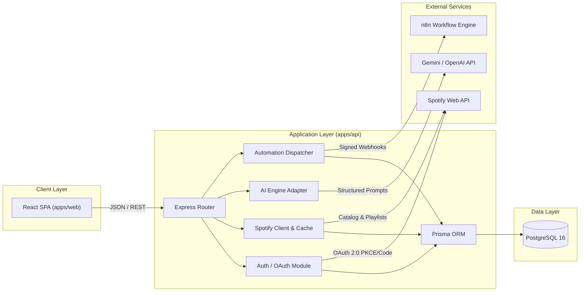

# Arquitetura do Sistema — SpotFlow AI

## 1. Visão Geral

O **SpotFlow AI** é uma plataforma distribuída em formato monorepo para curadoria musical inteligente e orquestração de automações, conectando a API oficial do Spotify, agentes de Inteligência Artificial e o orquestrador n8n.

---

## 2. Divisão de Responsabilidades

### `apps/web` (Frontend)
- Interface de usuário responsiva construída em React 19, TypeScript (strict mode) e Tailwind CSS.
- Gerenciamento de estado de servidor e cache assíncrono com TanStack Query.
- Roteamento declarativo com React Router.
- Interface orientada a feedback: estados explícitos de loading, erro, vazio e confirmação antes de qualquer ação irreversível.

### `apps/api` (Backend)
- Núcleo de regras de negócio em Node.js com Express e TypeScript.
- Arquitetura orientada a módulos de domínio:
  - `auth`: Ciclo de vida de tokens, fluxo OAuth com Spotify, sessões seguras.
  - `spotify`: Wrapper tipado com rate limiting, retry com backoff e tratamento de códigos 401/429.
  - `playlists`: Staging de playlists, curadoria, resolução de faixas e criação idempotente.
  - `automations`: Agendamento e despacho de rotinas para o n8n ou worker interno.
  - `ai`: Motor agnóstico de LLM (Gemini/OpenAI) com schema Zod rigoroso e fallback local.
  - `insights`: Agregação e cálculo de dados da biblioteca do usuário.
  - `executions`: Auditoria de execuções de automação e histórico de ações.
  - `settings`: Gerenciamento de preferências e exclusão segura de credenciais.

### `packages/shared`
- Tipos TypeScript puros, schemas Zod e constantes compartilhadas.
- Garante integridade total e sincronia entre frontend, backend e payloads do n8n.

### `automation/workflows`
- Workflows exportados do n8n em formato JSON versionado, prontos para importação.
- Configuração de webhooks autenticados por cabeçalho HMAC (`X-SpotFlow-Signature`).

---

## 3. Estratégia de Isolamento e Resiliência

1. **Desacoplamento do Provedor de IA**: O módulo `ai` implementa a interface `AIEngineProvider`, permitindo alternar entre Gemini, OpenAI ou mocks de teste sem alterar a regra de negócio.
2. **Resiliência contra Quedas do n8n**: Se a instância do n8n estiver offline, o sistema sinaliza status `degraded` e executa rotinas críticas diretamente pelo motor interno do backend, registrando o incidente.
3. **Proteção contra Mudanças da API do Spotify**: Toda chamada ao Spotify passa pelo `SpotifyClientAdapter`. Se um endpoint sofrer restrição, o adapter aciona o mecanismo de fallback sem propagar falhas fatais para a UI.
